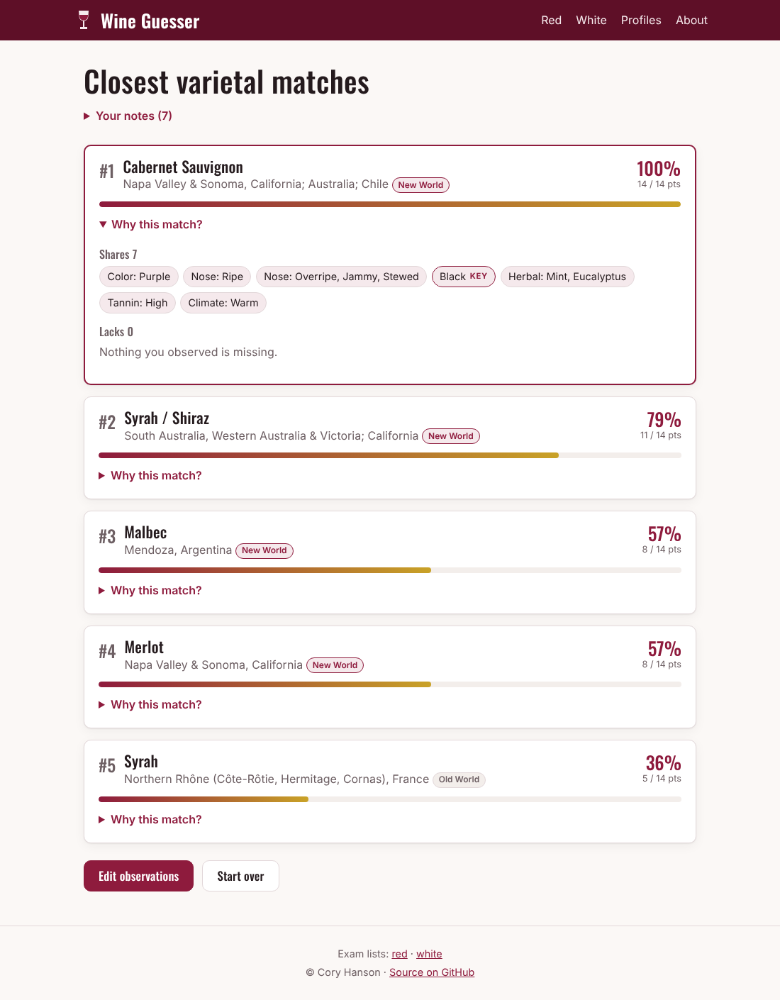

# Wine Guesser

A practice tool for blind tasters. Work through the deductive tasting grid, enter what you see, smell and taste, and Wine Guesser ranks the classic varietals from the Court of Master Sommeliers Certified exam lists that best fit your notes, and explains why.



## Features

- Red and white tasting grids: color, fruit condition, fruit, non-fruit, structure, climate (plus sweetness for whites).
- Mark notes **Yes**, or **Key** for defining markers; leave anything you are unsure of.
- Top five matches, each with a score, the traits it shares with your notes and the ones it lacks.
- Shareable result URLs; **Edit observations** reopens the form pre-filled.
- Browsable profiles for every varietal, with descriptions, notes and common confusions.
- Static site: no server, no database, no tracking. Works on phones and supports dark mode.

## Built with

TypeScript, [Vite](https://vite.dev/) and plain DOM rendering, tested with [Vitest](https://vitest.dev/).

## Getting started

Requires Node.js 20+.

```sh
npm install
npm run dev        # http://localhost:5173
```

| Script              | What it does                         |
| ------------------- | ------------------------------------ |
| `npm run dev`       | Start the dev server                 |
| `npm test`          | Run the unit tests                   |
| `npm run lint`      | Lint with ESLint                     |
| `npm run typecheck` | Type-check with `tsc`                |
| `npm run build`     | Type-check and build to `dist/`      |
| `npm run preview`   | Serve the production build locally   |

## Project layout

```
src/
  traits.ts       tasting-grid definition: every trait, its label and how it is entered
  scoring.ts      turns form input into traits and ranks the profiles
  data/red.json   red varietal profiles
  data/white.json white varietal profiles
  views/          pages (home, guess form, results, profiles, about)
tests/            scoring, trait catalog and data validation tests
public/files/     CMS examinable wine lists (PDF)
```

## Editing varietal profiles

Profiles live in `src/data/red.json` and `src/data/white.json`. Each entry looks like:

```json
{
  "id": "gamay-beaujolais",
  "varietal": "Gamay",
  "region": "Beaujolais (Villages, Cru), France",
  "newWorld": false,
  "traits": { "ruby": 1, "red_fruit": 2, "carbonic_maceration": 2, "tannin_low": 1 },
  "description": "...",
  "notes": "...",
  "confusion": "..."
}
```

- `traits` lists only the characteristics the wine shows: `1` = present, `2` = a key marker. Anything left out counts as absent. Valid trait ids are defined in `src/traits.ts`.
- Color, structure, climate, sweetness and fruit condition use `1` only. A profile may mark several levels in a group, e.g. `tannin_mod_plus` and `tannin_high`.
- `npm test` validates every profile (known trait ids, valid values, required fields, unique ids), so a bad edit fails CI.

The bundled profiles are a starting point written from typical textbook descriptions. Refine them to match your own tasting experience.

## How matching works

For every trait you mark **Yes** (1) or **Key** (2):

| Profile has the trait…            | Points |
| --------------------------------- | -----: |
| at the same strength              |     +2 |
| at the other strength (Yes ↔ Key) |     +1 |
| not at all                        |     −1 |

Traits left at No or Unsure are ignored. Profiles are ranked by score, and the percentage is the score out of the maximum possible for your notes.

## Deployment

Pushing to `master` runs `.github/workflows/deploy.yml`, which tests, builds and publishes `dist/` to GitHub Pages. To enable it once, go to **Settings → Pages → Build and deployment → Source** and choose **GitHub Actions**.

The build is a plain static folder with relative paths, so `dist/` can be hosted anywhere (Netlify, Cloudflare Pages, S3, a subdirectory on an existing site, and so on).

## History

Version 1 was a PHP/MySQL application with a login-protected admin area. Version 2 is a rewrite as a static TypeScript site. Along the way it fixes several matching bugs: color, structure and climate selections were silently dropped before scoring, the red nose checkboxes posted palate values, and red palate "tart" and white acid "moderate" could not be stored. It also removes the server-side attack surface entirely.

> **Note:** the old `private/db_credentials.php` committed a MySQL username and password to this public repository. If those credentials were ever used on a live server, rotate them.

## Author

[Cory Hanson](https://coryhanson.us)

## License

[MIT](LICENSE)
